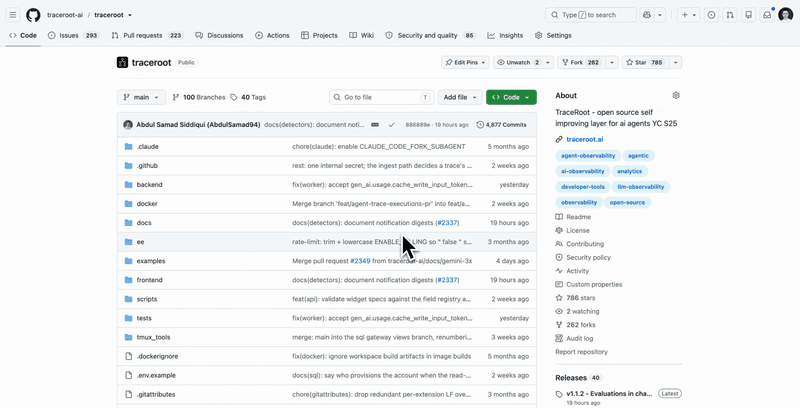

<div align="center">
  <a href="https://traceroot.ai/?utm_source=github&amp;utm_medium=referral&amp;utm_campaign=github-navigation&amp;utm_content=readme-logo-ja">
    <picture>
      <source media="(prefers-color-scheme: dark)" srcset="frontend/ui/public/images/traceroot_logo_dark.png">
      <source media="(prefers-color-scheme: light)" srcset="frontend/ui/public/images/traceroot_logo_light.png">
      
    </picture>
  </a>

traceroot: AIエージェントを継続的に改善するオープンソースプラットフォーム。

  [![Y Combinator][y-combinator-image]][y-combinator-url]
  [![License][license-image]][license-url]
  [![X (Twitter)][twitter-image]][twitter-url]
  [![Discord][discord-image]][discord-url]
  [![Documentation][docs-image]][docs-url]
  [![PyPI SDK Downloads][pypi-sdk-downloads-image]][pypi-sdk-downloads-url]
  [](https://deepwiki.com/traceroot-ai/traceroot)

  <p>
    <a href="https://traceroot.ai/?utm_source=github&amp;utm_medium=referral&amp;utm_campaign=github-navigation&amp;utm_content=readme-website-ja">Website</a> ·
    <a href="https://app.traceroot.ai">Cloud</a> ·
    <a href="https://traceroot.ai/docs/getting-started/introduction?utm_source=github&amp;utm_medium=referral&amp;utm_campaign=github-navigation&amp;utm_content=readme-docs-ja">Documentation</a> ·
    <a href="https://discord.gg/TM2m3CtKuC">Community</a>
  </p>
</div>

<p align="center">
  <a href="./README.md"></a>
  <a href="./README.zh.md"></a>
  <a href="./README.ko.md"></a>
  <a href="./README.ja.md"></a>
</p>

<p align="center">⭐ より多くの開発者にtracerootを届け、コミュニティを育てるために、このリポジトリにStarをお願いします！</p>

## traceroot

オープンソースの Braintrust 代替。エージェントの本番環境における問題のパターンを発見し、コーディングエージェントと共に検証済みの修正をデプロイします。

https://github.com/user-attachments/assets/2ecf21ce-93b3-41cb-8749-e02b77467357

## 主な機能

### 本番環境の失敗を検証済みの改善へと転換

本番環境の実行を追跡し、ディテクターで動作を評価して、繰り返し発生するパターンを改善シグナルとして抽出します。コーディングエージェントは traceroot CLI を使用してこれらのシグナルを調査し、ローカルでコードを変更した後、オフライン評価で検証します。デプロイ後は、新しい本番トレースが次の検出、シグナル分析、検証サイクルへとフィードバックされ、継続的な改善ループを形成します。

| ステップ | 説明 |
| ---- | ----------- |
| **[追跡](https://traceroot.ai/docs/tracing/get-started)** | 各モデル呼び出し、ツール呼び出し、レスポンスを、入力、出力、レイテンシ、コストとともに確認できます。 |
| **[検出](https://traceroot.ai/docs/detectors/get-started)** | 期待される動作を定義し、基準を満たさない本番実行に自動でフラグを立てます。 |
| **[シグナル](https://traceroot.ai/docs/signals/introduction)** | 評価モデルの出力をクラスタリングしてシグナルを作成します。バックグラウンドのコーディングエージェントがサンドボックス内でトレースと連携されたGitHubコードを調査し、修正案を提案します。 |
| **[検証](https://traceroot.ai/docs/evals/get-started)** | データセットに対して評価を実行し、バージョン間を比較して改善効果を測定し、リグレッションを検知します。 |

## ⭐ リポジトリにStarをお願いします

traceroot を気に入っていただけましたら、より多くの開発者に見つけてもらえるよう、Star ⭐ をお願いします。

<p align="center">
  <a href="https://github.com/traceroot-ai/traceroot">
    
  </a>
</p>

## traceroot のセットアップ

最初のトレースを [traceroot Cloud](https://app.traceroot.ai) または独自の [traceroot インスタンス](#traceroot-を始める) に送信しましょう。1つのコマンドを実行してコーディングエージェントに計測を追加させるか、SDKを手動で設定できます。

### コーディングエージェントでセットアップ

<a id="cli-quickstart"></a>

追跡したいリポジトリのルートで以下を実行します：

```bash
npx -y traceroot-cli@latest setup
```

Claude Code、Codex、Cursor、OpenCode、Pi、Antigravity などに対応しています。

[traceroot CLI](https://github.com/traceroot-ai/traceroot-cli#readme) はブラウザ経由でサインイン（無料アカウントの作成が可能）し、プロジェクトAPIキーをアプリケーションの env ファイルに書き込み、Claude Code や Codex に SDK を追加させ、最初のトレースを待機します。Node.js 20.12 以降が必要です。

- 別のコーディングエージェントをお使いですか？セットアップコマンドで変更内容をタスクとして出力し、実行させることができます。
- セルフホスティングの場合：`--host`（APIのオリジン）と `--auth-host`（ウェブアプリのオリジン）でインスタンスを指定してください。

各ステップ、セルフホスティング、トラブルシューティングについては、[セットアップガイド](https://traceroot.ai/docs/tracing/get-started) をご覧ください。

### SDKで手動セットアップ

自身で計測を設定したい場合は、**[Python SDK](https://github.com/traceroot-ai/traceroot-py#readme)** または **[TypeScript SDK](https://github.com/traceroot-ai/traceroot-ts#readme)** を使用してください。以下の例は、TypeScriptアプリケーションからモデル呼び出しのトレースを1件送信します。

<details>
<summary>最小限の TypeScript の例を実行する</summary>

Node.js、npm、traceroot プロジェクトAPIキー、OpenAI APIキーが必要です。セルフホスティングの場合は、以下のホストURLをご自身のインスタンスのAPIオリジン（例: `http://localhost:8000`）に置き換えてください。

**1. SDKをインストール:** TypeScriptプロジェクトで実行します:

```sh
npm install @traceroot-ai/traceroot openai
```

**2. APIキーを設定:**

```bash
export TRACEROOT_API_KEY="your-project-api-key"
export TRACEROOT_HOST_URL="https://app.traceroot.ai"
export OPENAI_API_KEY="your-openai-api-key"
```

**3. エージェントの呼び出しを追跡:** 以下を `example.ts` として保存します:

```typescript
import OpenAI from 'openai';
import { TraceRoot, observe } from '@traceroot-ai/traceroot';

TraceRoot.initialize({ instrumentModules: { openAI: OpenAI } });
const openai = new OpenAI();

const myAgent = observe({ name: 'my_agent', type: 'agent' }, async (query: string) => {
  const response = await openai.chat.completions.create({
    model: 'gpt-4o',
    messages: [{ role: 'user', content: query }],
  });
  return response.choices[0].message.content;
});

async function main() {
  try {
    await myAgent("What's the weather in SF?");
  } finally {
    await TraceRoot.shutdown();
  }
}

main().catch(console.error);
```

**4. 実行:** `npx tsx example.ts` を実行し、プロジェクトの **Traces** ページでエージェントの実行を確認します。この例ではOpenAI APIを1回呼び出します。

</details>

## traceroot を始める

### traceroot Cloud

プラットフォームをご自身で運用することなく開始するには、[アカウントを作成](https://app.traceroot.ai) してください。

### セルフホスティング

Git、Docker Compose、Make がインストールされている状態で、ローカルで以下を実行します：

```bash
git clone https://github.com/traceroot-ai/traceroot.git
cd traceroot
cp .env.example .env
make prod-lite
```

`make prod-lite` は `.env` に独自の認証情報を生成します。そのファイルのバックアップを保持してください。既存インストールのアップグレードについては、以下のガイドを参照してください。

[localhost:3000](http://localhost:3000) を開きます。設定とデプロイの詳細については、[セルフホスティングガイド](https://traceroot.ai/docs/developer/self-hosting) をご覧ください。

## 統合

### ネイティブ SDK

| 言語 | リポジトリ |
| -------- | ---------- |
| Python | [traceroot-py](https://github.com/traceroot-ai/traceroot-py) |
| TypeScript | [traceroot-ts](https://github.com/traceroot-ai/traceroot-ts) |

<details open>
<summary>サポートされているフレームワーク、モデルプロバイダー、コーディングエージェント</summary>

### エージェントフレームワーク

| 統合 | 対応言語 | 説明 |
| ----------- | -------- | ----------- |
| [Agno](https://traceroot.ai/docs/integrations/agno) | Python | エージェントの実行、ツール呼び出し、マルチステップの推論を自動計測します。 |
| [AutoGen](https://traceroot.ai/docs/integrations/autogen) | Python | マルチエージェントの会話、エージェントループ、ツール呼び出しを自動計測します。 |
| [Claude Agent SDK](https://traceroot.ai/docs/integrations/claude-agent-sdk) | Python, JS/TS | エージェントの呼び出し、サブエージェントへの委任、ツール呼び出し、トークン使用量を自動計測します。 |
| [CrewAI](https://traceroot.ai/docs/integrations/crewai) | Python | マルチエージェントの協調ワークフローとタスク実行を自動計測します。 |
| [DSPy](https://traceroot.ai/docs/integrations/dspy) | Python | モジュールの実行、シグネチャの予測、基盤となるLLM呼び出しを自動計測します。 |
| [Google ADK](https://traceroot.ai/docs/integrations/google-adk) | Python | エージェントの実行、ツールの実行、マルチターンエージェントループを自動計測します。 |
| [LangChain & LangGraph](https://traceroot.ai/docs/integrations/langchain) | Python, JS/TS | LangChainアプリケーションにコールバックハンドラーを渡すことで自動計測します。 |
| [LangChain DeepAgents](https://traceroot.ai/docs/integrations/langchain-deepagents) | Python, JS/TS | DeepAgentsパイプラインにコールバックハンドラーを渡すことで自動計測します。 |
| [LlamaIndex](https://traceroot.ai/docs/integrations/llamaindex) | Python | RAGパイプライン、ドキュメントのインジェスチョン、検索、LLMによる要約を自動計測します。 |
| [Microsoft Agent Framework](https://traceroot.ai/docs/integrations/microsoft-agent-framework) | Python | Agent Frameworkに組み込まれたOpenTelemetryを介して、エージェントの実行、モデル呼び出し、ツールの実行を自動計測します。 |
| [Mastra](https://traceroot.ai/docs/integrations/mastra) | JS/TS | traceroot OTLPエクスポーターを介して自動計測します。 |
| [OpenAI Agents SDK](https://traceroot.ai/docs/integrations/openai-agents-sdk) | Python, JS/TS | エージェントの実行、ツールの実行、ハンドオフの遷移を自動計測します。 |
| [Pydantic AI](https://traceroot.ai/docs/integrations/pydantic-ai) | Python | pydantic-aiのネイティブOpenTelemetryサポートを介して、エージェントの実行、LLM呼び出し、ツール呼び出しを自動計測します。 |
| [Vercel AI SDK](https://traceroot.ai/docs/integrations/vercel-ai) | JS/TS | ネイティブOpenTelemetryトレース — `instrumentModules`の設定は不要です。AI SDK 7には`@ai-sdk/otel`が必要で、AI SDK 6（レガシー）は`experimental_telemetry`を使用します。 |

### モデルプロバイダー

| 統合 | 対応言語 | 説明 |
| ----------- | -------- | ----------- |
| [Anthropic](https://traceroot.ai/docs/integrations/anthropic) | Python, JS/TS | Messages APIを自動計測します。 |
| [Google Gemini](https://traceroot.ai/docs/integrations/gemini) | Python | Google GenAI SDK経由で自動計測します。 |
| [Mistral](https://traceroot.ai/docs/integrations/mistral) | Python | Mistralのチャット完了、ツール呼び出し、ストリーミングレスポンスを自動計測します。 |
| [OpenAI](https://traceroot.ai/docs/integrations/openai) | Python, JS/TS | Chat CompletionsおよびResponses APIを自動計測します。 |
| [OpenRouter](https://traceroot.ai/docs/integrations/openrouter) | Python, JS/TS | OpenAI SDKのbase URL経由でOpenAI互換トレースを収集します。[Python](./examples/python/openrouter-tool-agent)および[TypeScript](./examples/typescript/openrouter)の例を参照してください。 |

### コーディングエージェント

| 統合 | 対応言語 | 説明 |
| ----------- | -------- | ----------- |
| [Claude Code](https://traceroot.ai/docs/integrations/claude-code) | プラグイン | tracerootプラグインを使用して、Claude Codeのリクエスト、ツール呼び出し、サブエージェント、トークン使用量を追跡します。 |
| [Codex](https://traceroot.ai/docs/integrations/codex) | プラグイン | tracerootプラグインを使用して、Codexのターン、ツール呼び出し、サブエージェント、トークン使用量をリアルタイムに追跡します。 |
| [pi CLI](https://traceroot.ai/docs/integrations/pi-cli) | 拡張機能 | traceroot拡張機能を使用して、対話型pi CLIセッション、ターン、ツール呼び出し、トークン使用量を追跡します。 |

</details>

> お使いのフレームワークやプロバイダーが見当たりませんか？[統合をリクエスト](https://github.com/traceroot-ai/traceroot/issues)してください。

## Security & Privacy

データのセキュリティとプライバシーは最優先事項です。詳細については、[Security and Privacy](SECURITY.md) をご覧ください。

## Community

エージェントランタイムを支える [pi-mono](https://github.com/badlogic/pi-mono) に深く感謝いたします。

**貢献する** 🤝: コード、ドキュメント、統合、実行可能なサンプルでの貢献をお待ちしています。[コントリビューションガイド](CONTRIBUTING.md) および [承認不要で未アサインの初心者向けイシュー](https://github.com/traceroot-ai/traceroot/issues?q=is%3Aissue%20is%3Aopen%20label%3A%22good%20first%20issue%22%20-label%3A%22needs%20approval%22%20no%3Aassignee) から始めてみてください。

**サポート** 💬: サポートが必要な場合は、[Discord チャンネル](https://discord.gg/TM2m3CtKuC) での問い合わせが最も迅速です。`founders@traceroot.ai` へのメールでもお気軽にお問い合わせください。

## License

traceroot は、`ee` という名前のディレクトリ以外のコードに [Apache 2.0](LICENSE) を適用しています。これらのディレクトリは [Enterprise License](ee/LICENSE) の対象となります。

## Star History

<p align="center">
<a href="https://star-history.com/#traceroot-ai/traceroot&Date">
 <picture>
   <source media="(prefers-color-scheme: dark)" srcset="https://api.star-history.com/svg?repos=traceroot-ai/traceroot&type=Date&theme=dark" />
   <source media="(prefers-color-scheme: light)" srcset="https://api.star-history.com/svg?repos=traceroot-ai/traceroot&type=Date" />
   
 </picture>
</a>
</p>

## Contributors

<p align="center">
<a href="https://github.com/traceroot-ai/traceroot/graphs/contributors">
  
</a>
</p>

<br>

<p align="center">⭐ <b>GitHubでStarを付けて</b> tracerootを応援してください！</p>

<!-- Links -->
[discord-image]: https://img.shields.io/discord/1395844148568920114?logo=discord&labelColor=%235462eb&logoColor=%23f5f5f5&color=%235462eb
[discord-url]: https://discord.gg/TM2m3CtKuC
[license-image]: https://img.shields.io/badge/License-Apache%202.0-blue.svg
[license-url]: https://opensource.org/licenses/Apache-2.0
[docs-image]: https://img.shields.io/badge/docs-traceroot.ai-0dbf43
[docs-url]: https://traceroot.ai/docs
[pypi-sdk-downloads-image]: https://static.pepy.tech/badge/traceroot
[pypi-sdk-downloads-url]: https://pypi.python.org/pypi/traceroot
[y-combinator-image]: https://img.shields.io/badge/Combinator-S25-orange?logo=ycombinator&labelColor=white
[y-combinator-url]: https://www.ycombinator.com/companies/traceroot-ai
[twitter-image]: https://img.shields.io/twitter/follow/TraceRootAI
[twitter-url]: https://x.com/TraceRootAI
