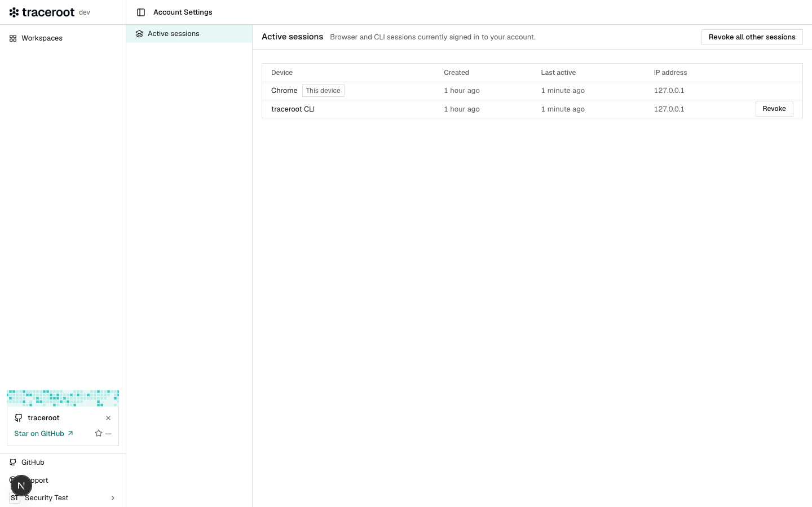
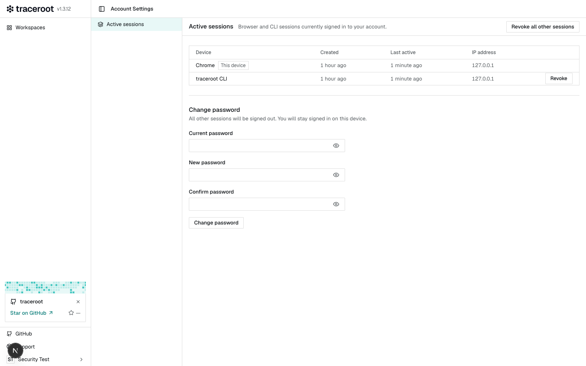
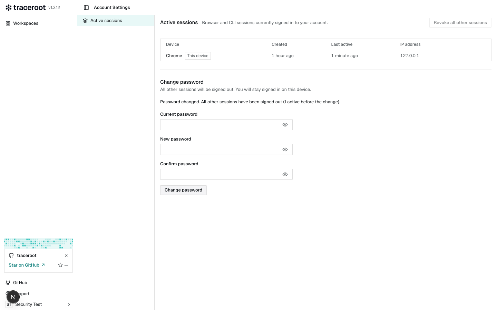
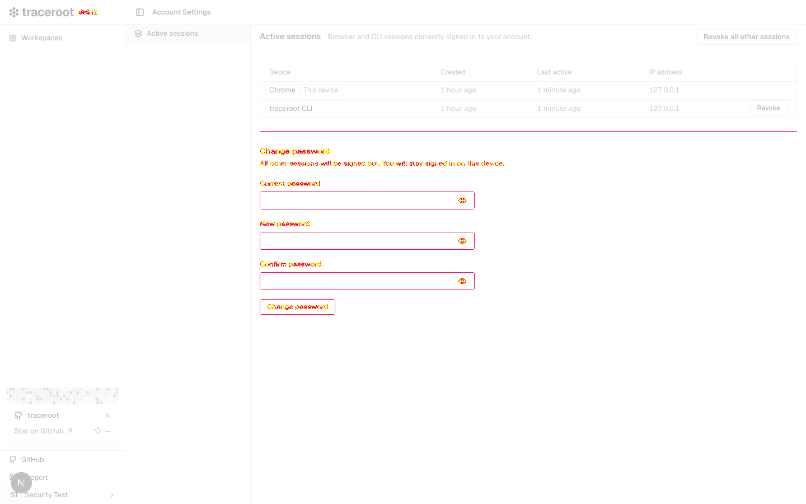
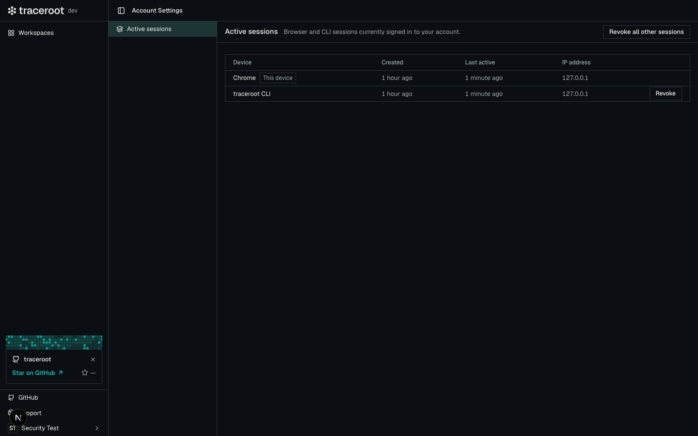
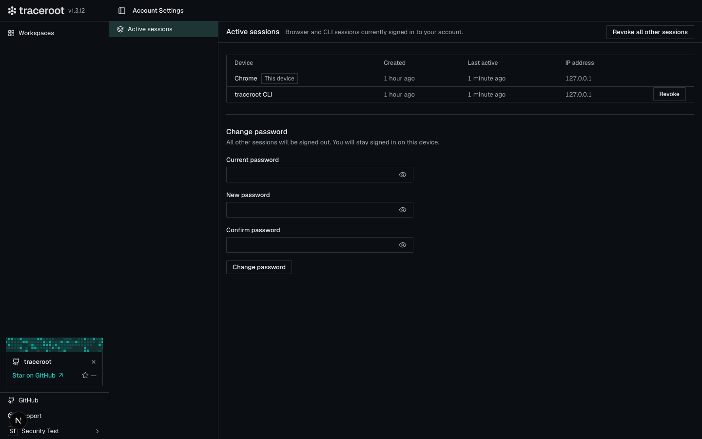
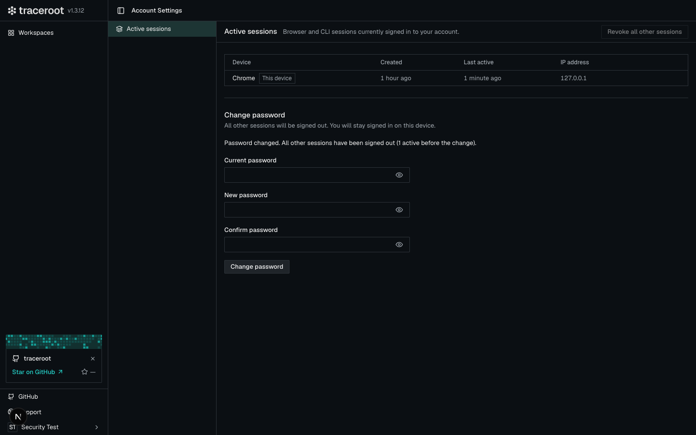
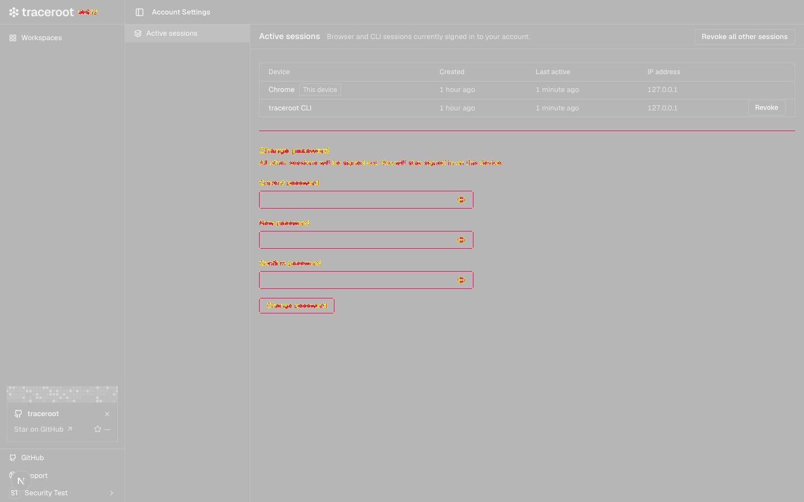

# Password change session revocation: UI evidence

Fixture-backed visual evidence: the before server uses origin/main 2d11d7e28211e18277ca6d50032f9bd371a927b9, the after server uses the PR branch. Both are actual independent Next.js dev servers with fixed API fixtures, identical dates, session rows and viewports. These pictures establish layout, not authentication correctness.

## Criteria

- At 1440x900 in both light/dark themes, the change-password form and confirmation are legible and consistent with existing account settings controls.
- At 1024/768/390 widths, document horizontal overflow is 0px. At 390px, password inputs and submit control remain usable; show navigation drawer too.
- Show before and after, success feedback, and pixel differences. Do not mislabel fixture results as real service results.
- New text and outlined button use foreground/background (19.19:1 light, 17.18:1 dark); helper text uses muted-foreground/background (6.70:1, 8.01:1). Focus ring/background is 5.04:1 and 7.74:1. The existing primary-button white/teal pair is 2.39:1; the new button deliberately uses outline instead.
- Each video is at most 30 seconds, 1280x720, recorded after compilation, ending on a clean page. Before chapter: active sessions. After chapters: form, submit, confirmation.

## Screenshots

| Theme | Before | After | Success | Pixel diff |
|---|---|---|---|---|
| Light |  |  |  |  |
| Dark |  |  |  |  |

[Before video](videos/before.webm) · [After video](videos/after.webm)

[Widths and chapters](visual-results.json) · [Pixel diff counts](pixel-diff.txt) · [Full theme contrast table](contrast.md)

## Real service verification (separate from fixtures)

Local Next.js + isolated PostgreSQL 16: forcing revokeOtherSessions=false is overridden; old cookies fail; old session CLI mint returns 401; replacement session works. A PostgreSQL trigger deliberately failing the password write proves credential and session changes roll back together. Existing reset mail was delivered to a localhost-only SMTP receiver and completing the reset revokes every old session.

Actual Chrome + those services: changed the password through the form, confirmed old browser session invalidation, recognized the new current session with no self-revoke button, no page errors and no document overflow at 1024/768/390.

[HTTP/DB results](live-results.json) · [Browser results](browser-results.json)

Production deployment and external remediation retesting have not been performed. Already issued CLI JWT expiry/validation policy is unchanged.

The real browser also observed HTTP 403 from the pre-existing public GitHub star-count widget (`api.github.com/repos/traceroot-ai/traceroot`); authentication requests passed and no page exception occurred.
