# Demo opt-in — fixture-backed visual evidence

Before: `b8a7cd195`; after: `286ca0e3b`. Running local Next builds, fixed synthetic API fixtures, light/dark themes and Chrome. These captures prove layout and interaction presentation only. The real database-backed consent/revocation test is reported separately in the PR; production content and deployment were not tested.

The new `/demo` page has no pre-existing page to compare on main. Existing tracing/onboarding entry pages retain their layout and now point to the explicit entry page. Local command examples use port 3110 before and 3109 after.

## Criteria and results

| Check | Result |
|---|---|
| Existing entry surfaces, light/dark, 1440×900 | Captured before/after and pixel diffs |
| New Join/Open/Leave/error page, light/dark | Captured |
| Widths 1024, 768, 390 | 0 px document overflow in all 21 checks |
| Mobile navigation drawer | Captured at 390 px |
| Browser page errors / unknown API fixture routes | None |
| Video | Before and after, 1280×720, each below 30 seconds |

| Pair | Light | Dark | Target |
|---|---:|---:|---:|
| foreground on background | 19.19:1 | 17.18:1 | 4.5:1 |
| card-foreground on card | 19.19:1 | 16.51:1 | 4.5:1 |
| muted-foreground on card | 6.70:1 | 7.70:1 | 4.5:1 |
| primary-ink on primary | 7.78:1 | 7.78:1 | 4.5:1 |
| danger on card | 7.51:1 | 6.57:1 | 4.5:1 |
| ring on card | 5.04:1 | 7.44:1 | 3:1 |

## Videos

[Before video](before.webm) · [After video](after.webm)

**Before chapters:** 0.0s trace-entry, 1.6s onboarding-entry.

**After chapters:** 0.0s trace-entry, 1.7s onboarding-entry, 3.3s demo-join, 4.8s demo-joined, 7.2s leave-demo.

## Existing entry surfaces

### trace-entry, light

| Before | After | Pixel diff |
|---|---|---|
| 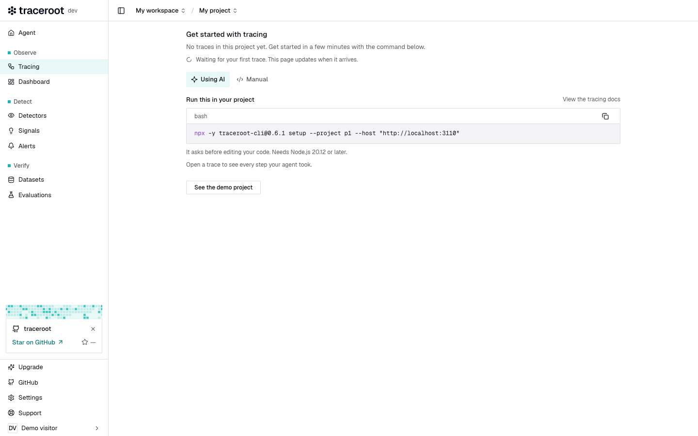 |  | 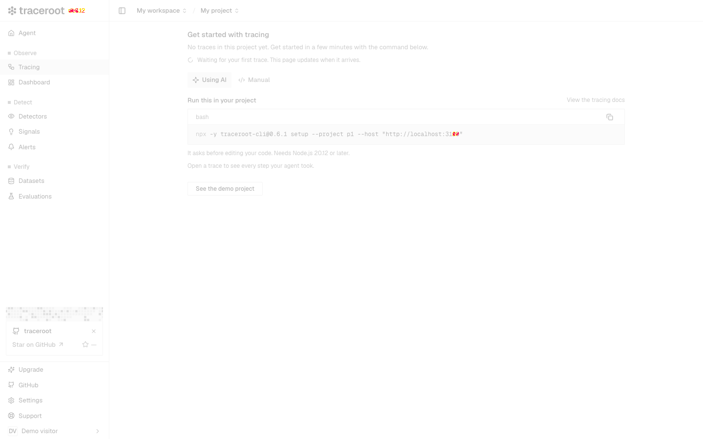 |

### trace-entry, dark

| Before | After | Pixel diff |
|---|---|---|
|  |  |  |

### onboarding-entry, light

| Before | After | Pixel diff |
|---|---|---|
|  | 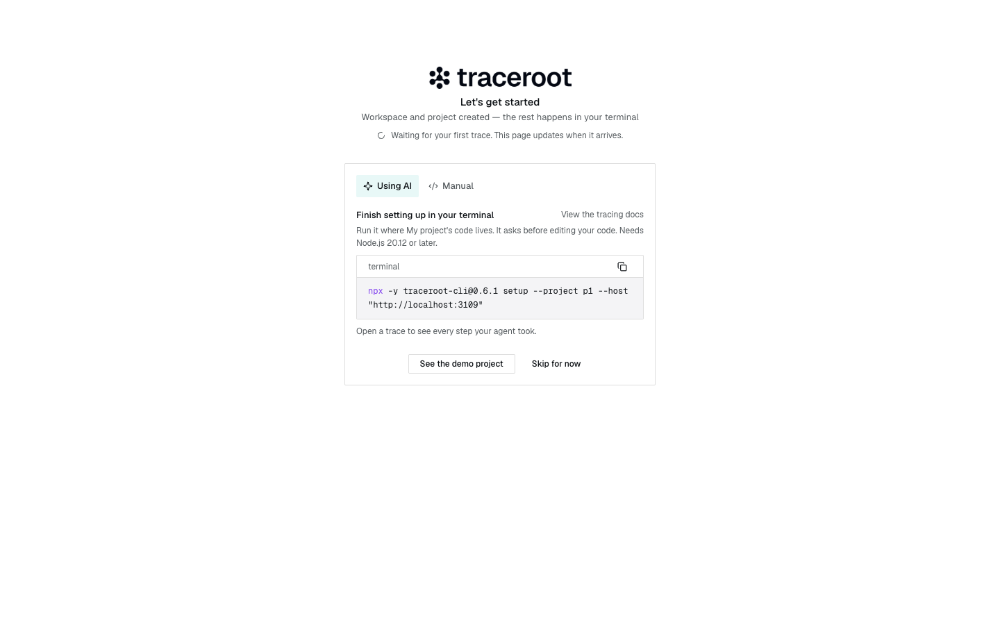 |  |

### onboarding-entry, dark

| Before | After | Pixel diff |
|---|---|---|
|  |  | 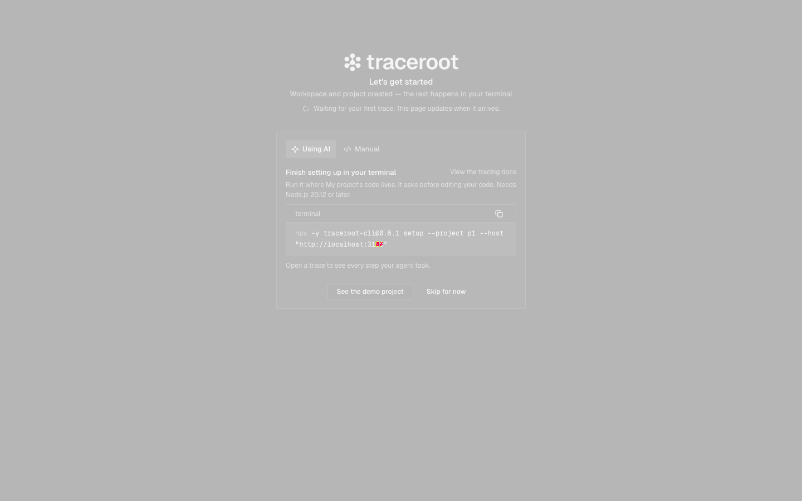 |

## New explicit entry page

### demo-join

| Light | Dark |
|---|---|
|  |  |

### demo-joined

| Light | Dark |
|---|---|
| 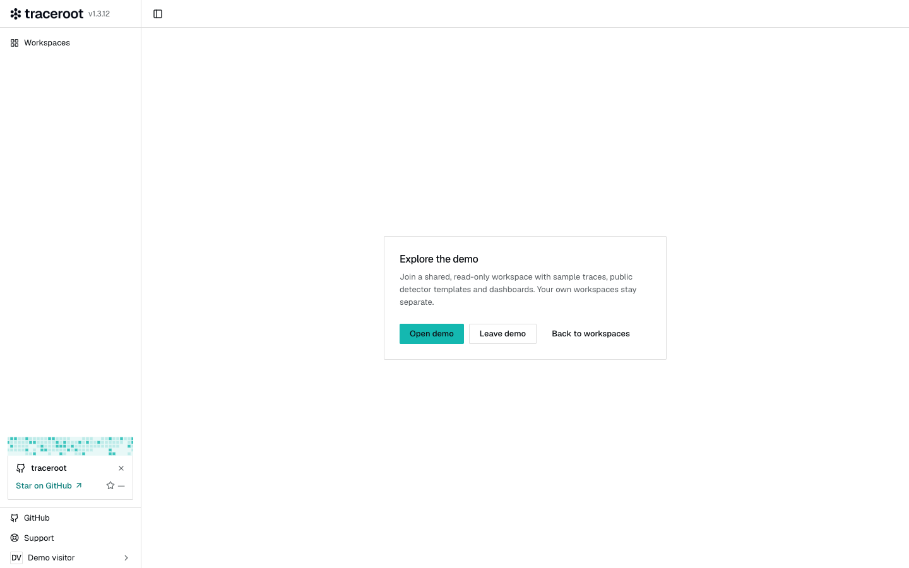 | 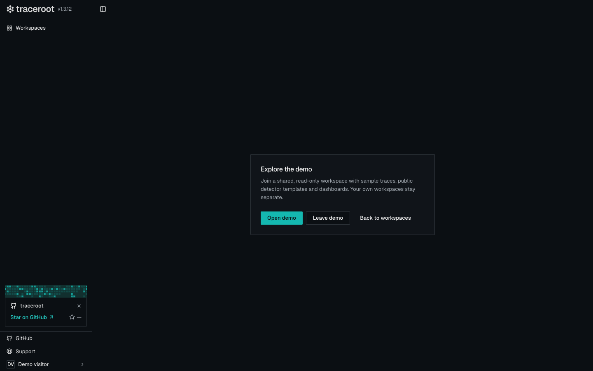 |

### demo-error

| Light | Dark |
|---|---|
| 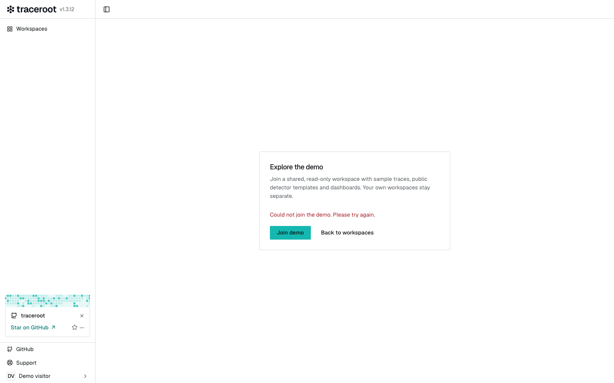 | 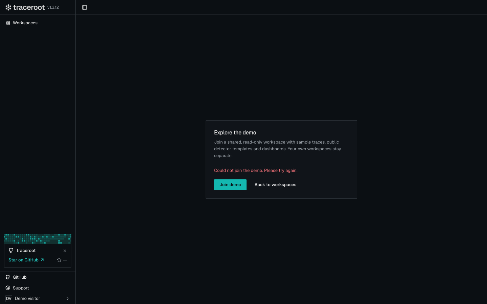 |

## Narrow viewports

### trace-entry

| 1024 | 768 | 390 |
|---|---|---|
| 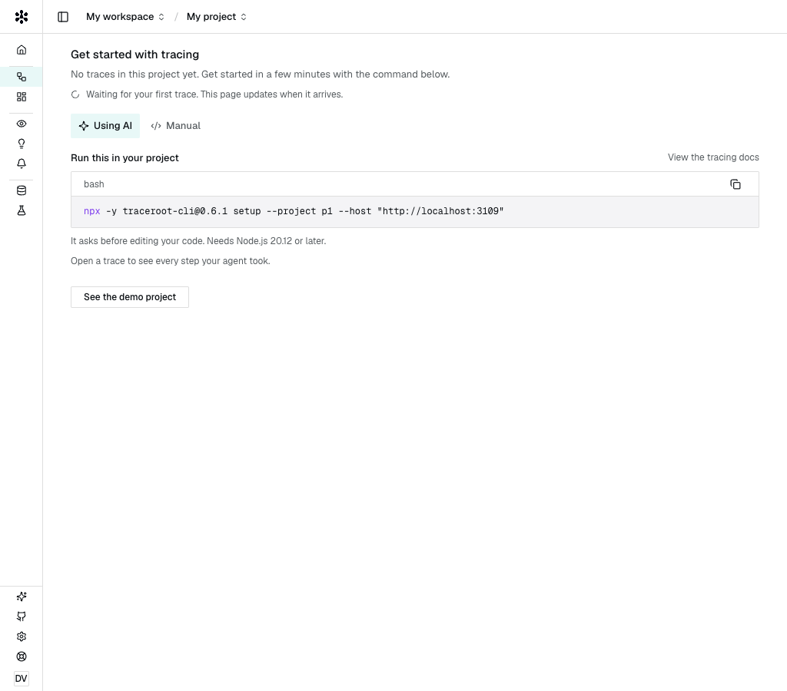 |  | 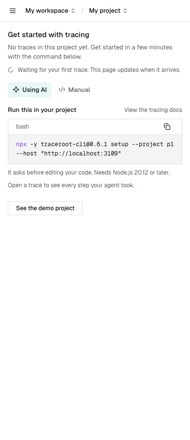 |

### onboarding-entry

| 1024 | 768 | 390 |
|---|---|---|
|  |  |  |

### demo-join

| 1024 | 768 | 390 |
|---|---|---|
|  | 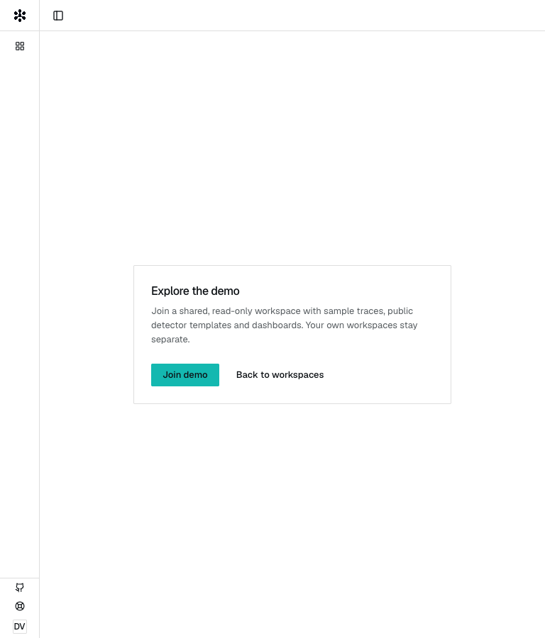 |  |

### demo-joined

| 1024 | 768 | 390 |
|---|---|---|
|  | 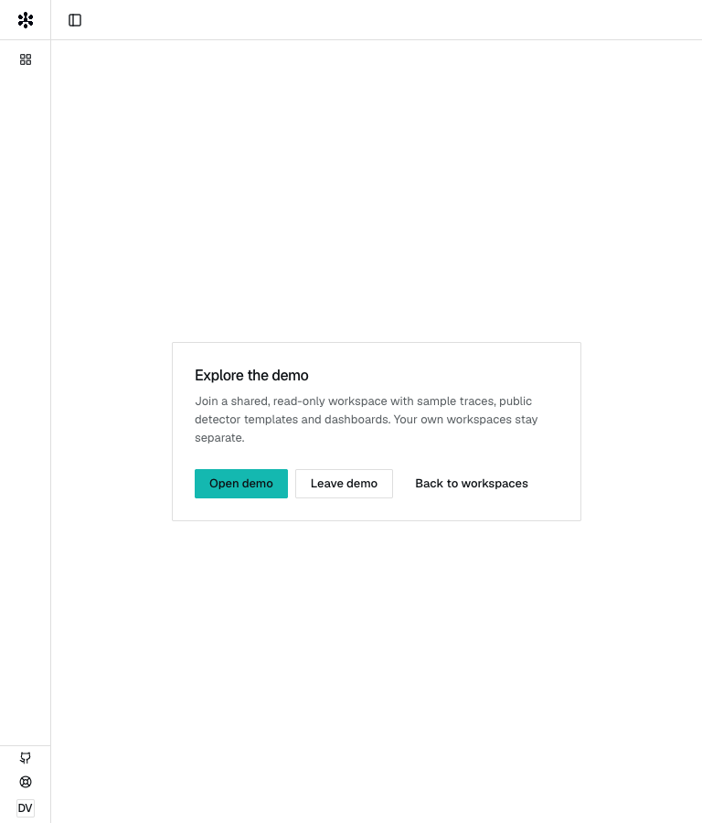 |  |

### demo-error

| 1024 | 768 | 390 |
|---|---|---|
| 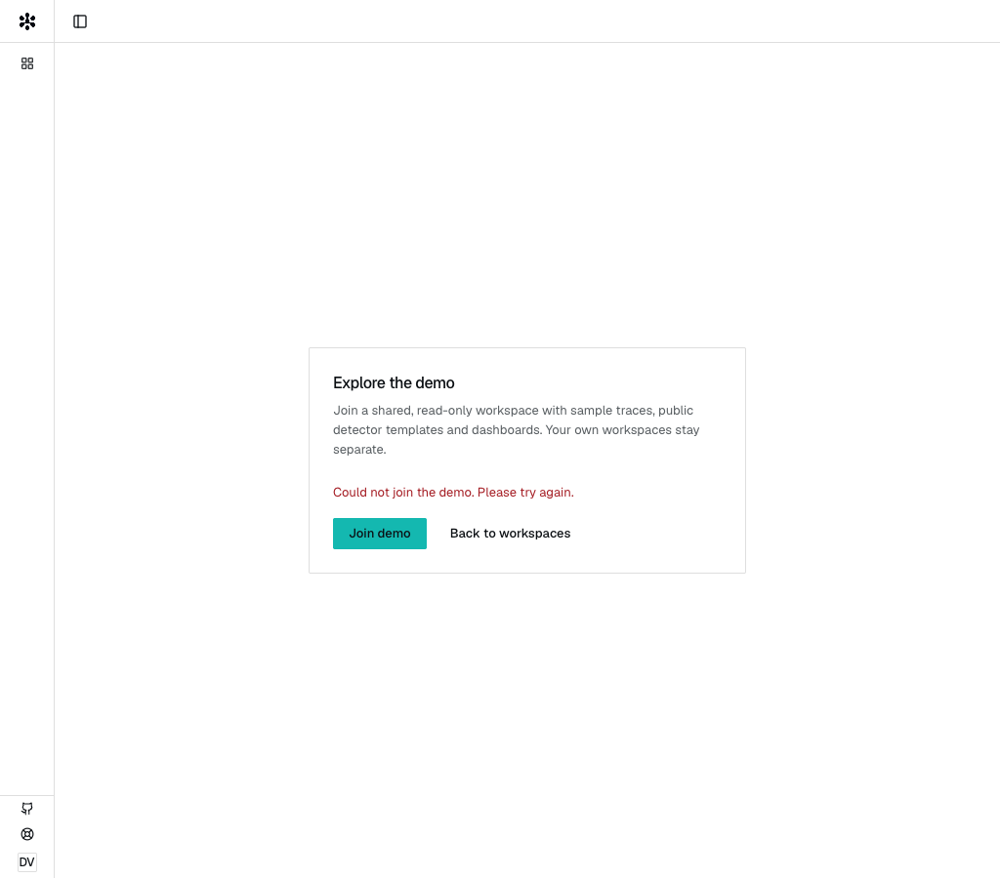 |  |  |

[Machine-readable overflow/console checks](checks.json) · [Changed pixel counts](pixel-diffs.json)
