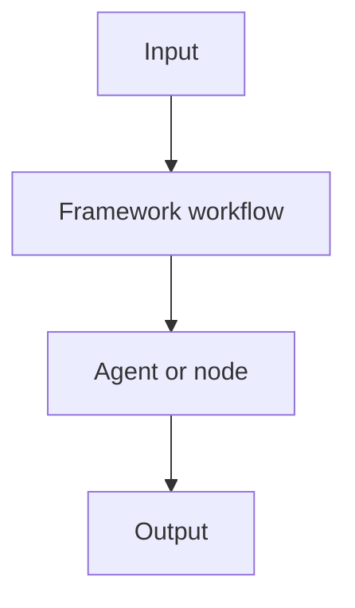
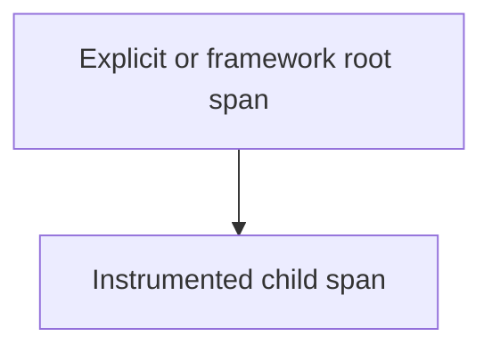

# `[Example name]` (`[Language]` / `[Framework]`)

Use this structure for example READMEs. Replace the bracketed prompts with facts
verified from the example source and its TraceRoot integration. Keep architecture
diagrams separate from trace diagrams: the former shows application behavior; the
latter shows instrumentation that actually creates or exports spans.

## Overview

Describe the example's purpose and agent pattern. Name the agents, workflow, and
framework components that are actually present.

## Architecture and execution flow

Explain the entry point, execution order, transitions, model calls, and tools.
Call out conditional paths and whether any handoff or state transfer is explicit.

## TraceRoot instrumentation architecture

Identify the initialization or exporter setup, integration modules, decorators,
and context/metadata helpers. Distinguish automatic instrumentation from spans
created explicitly by the example.

## Resulting span hierarchy

Show only parent-child relationships supported by the implementation. Mark
illustrative or runtime-dependent spans as such, and do not invent span names.

## Observed telemetry and supported features

List only fields emitted by the configured instrumentations (for example input
and output, model, token usage, tool calls, or session metadata). Qualify
conditional fields such as cost, and say when a feature depends on provider
responses or model pricing data.

## Prerequisites and environment variables

List the required runtime, credentials, services, and exact variable names from
the example's environment file. Do not include real credentials.

## Installation and execution

Provide copy-pasteable commands that match the checked-in manifests and scripts.
Include all supported entry points.

## File walkthrough

Link to the important source and configuration files with relative Markdown
links. Explain where the entry point, instrumentation, agents/workflow, tools,
and environment configuration live.
