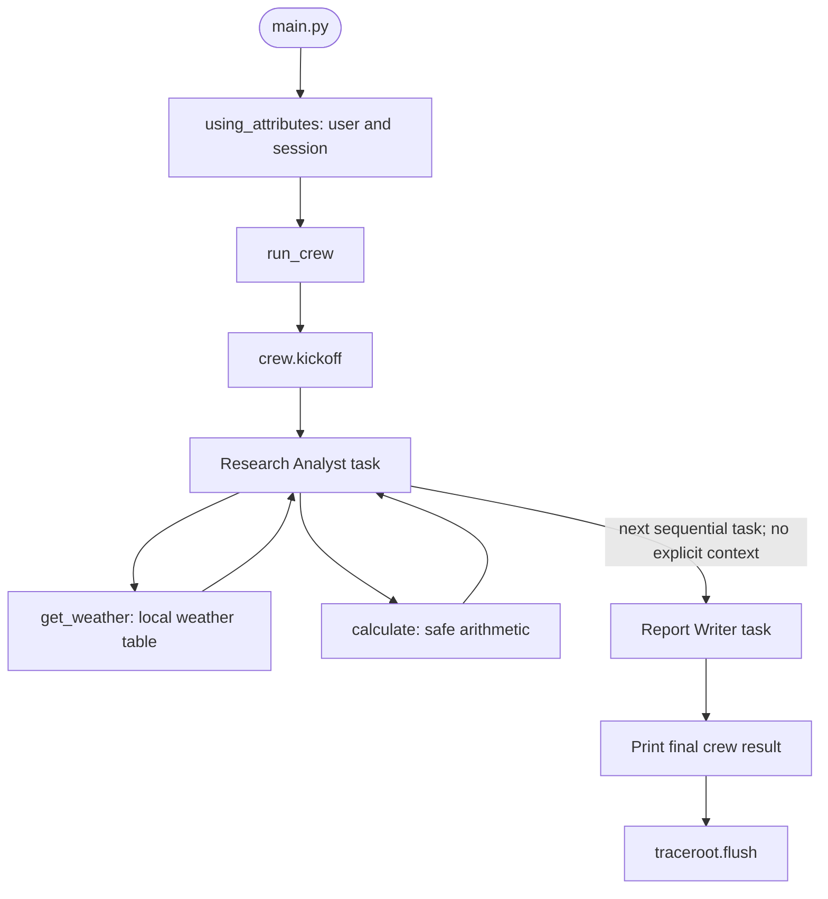
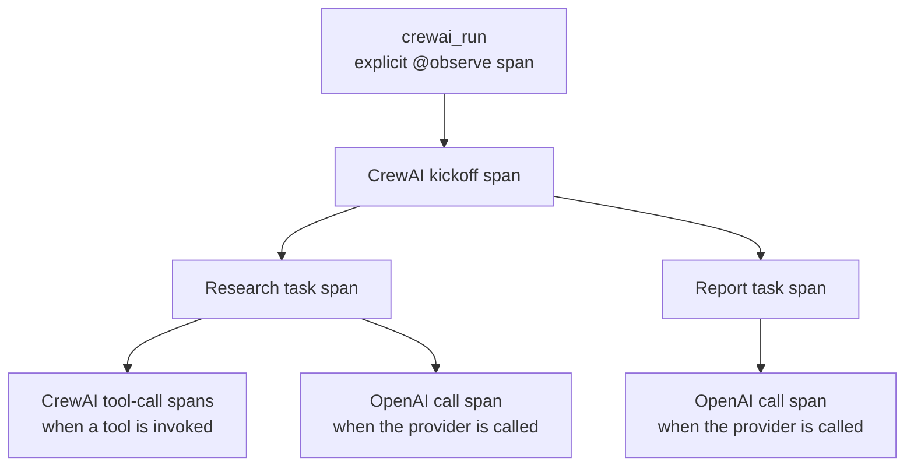

# CrewAI Weather Report (`Python` / `CrewAI`)

## Overview

This example runs a two-agent CrewAI crew. A **Research Analyst** researches a
weather comparison and can use local weather and arithmetic tools; a **Report
Writer** is assigned the report task. CrewAI runs the tasks in list order using
its default sequential process. The writer task does not declare an explicit
`context=[research_task]` handoff.

## Architecture and execution flow

`main.py` loads `.env`, configures TraceRoot before importing CrewAI, defines
the tools, agents, tasks and crew, then calls `crew.kickoff()` from `run_crew`.
The Research Analyst may call `get_weather` and `calculate`; both use local
logic/data rather than external services. The Report Writer then runs its
assigned task. `using_attributes` supplies the example user and session context
for this run.



## TraceRoot instrumentation architecture

`traceroot.initialize` enables the CrewAI and OpenAI integrations before
CrewAI is imported, allowing their instrumentation to attach. The explicit
`@observe(name="crewai_run", type="agent")` wrapper records the call to
`crew.kickoff()`. `using_attributes` adds `user_id="example-user"` and
`session_id="crewai-session"` to spans created in its context. The OpenAI
integration is enabled because CrewAI delegates model calls to its configured
provider; this example leaves the model at CrewAI's default rather than naming
one in code.

This trace makes the crew, task and provider activity inspectable together so
developers can attribute outputs and usage to the work that produced them.

## Resulting span hierarchy

The explicit `crewai_run` span wraps CrewAI's instrumented kickoff. CrewAI
instrumentation can add spans for the crew, tasks and invoked tools; the OpenAI
integration can add spans for provider calls. This tree shows the expected
relationships, not guaranteed runtime span names or calls: task/tool spans
depend on the instrumentation and execution path, and provider spans depend on
the calls made by CrewAI.



## Observed telemetry and supported features

- The explicit wrapper records the `run_crew` call's result; the TraceRoot
  context adds the configured user and session identifiers.
- The CrewAI integration supports crew execution, agent/task details, and
  invoked tool calls. The OpenAI integration captures provider calls and
  available usage data.
- Token usage depends on usage being returned by the provider. TraceRoot cost
  is conditional on recognized model and usage data; this example does not set
  a cost value itself. Span durations reflect completed instrumented calls.
- The weather and arithmetic tools are local functions, not separately
  TraceRoot-decorated functions. Their spans, if present, come from CrewAI's
  integration rather than explicit decorators in this file.

## Prerequisites and environment variables

- Python 3.13 (the `uv` command below provisions it if needed).
- A TraceRoot API key and an OpenAI API key.
- Environment variables are listed in
  [`.env.example`](.env.example): `TRACEROOT_API_KEY` and `OPENAI_API_KEY`.
  `TRACEROOT_HOST_URL` is an optional endpoint override.
- CrewAI's default LLM/provider behavior is used; no model is configured in
  `main.py`.

## Installation and execution

From this directory, create `.env`, fill in the credentials, and run:

```bash
cp .env.example .env
uv run --no-project --python 3.13 --with-requirements requirements.txt python main.py
```

`uv` installs the requirements listed in [`requirements.txt`](requirements.txt)
for this run without creating a project lockfile.

## File walkthrough

- [`main.py`](main.py) loads environment variables, initializes TraceRoot,
  defines tools/agents/tasks, wraps the crew run, and flushes spans.
- [`requirements.txt`](requirements.txt) lists the Python packages used by the
  example.
- [`.env.example`](.env.example) names the TraceRoot and OpenAI settings.
