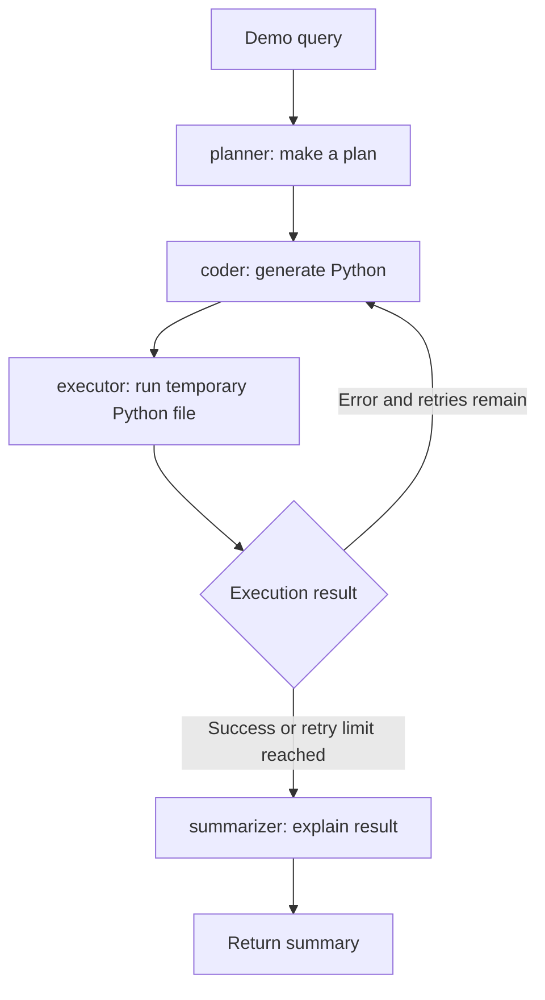
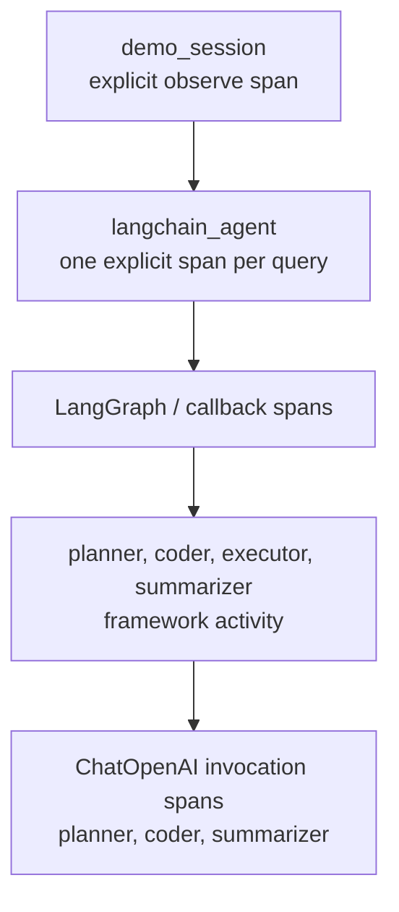

# LangGraph Code Agent (`TypeScript` / `LangChain`)

## Overview

This example uses a LangGraph `StateGraph` as a code-generation workflow. Its
planner, coder, executor and summarizer are graph nodes sharing typed state;
they are not four independently constructed agent objects. The workflow asks
`gpt-4o-mini` to plan, generate Python, and summarize the result. The executor
runs the generated code locally.

## Architecture and execution flow

`agent.ts` loads environment variables and initializes TraceRoot's LangChain
callback instrumentation. `main` runs three demo queries inside one
`demo_session` span. For each query, `runAgent` invokes the graph: `planner`
leads to `coder`, then `executor`. A successful execution proceeds to
`summarizer`; an `ERROR:` result loops back to `coder` for up to two retries,
then proceeds to summarization. The executor writes generated code to a
temporary file and launches `python3` with a 30-second timeout; the subprocess
is not separately instrumented as a TraceRoot tool.



## TraceRoot instrumentation architecture

`TraceRoot.initialize` is given the LangChain callback-manager module, enabling
the SDK's LangChain instrumentation for this ESM application. It deliberately
does not enable the separate OpenAI instrumentation: `ChatOpenAI` calls already
pass through LangChain, and instrumenting OpenAI as well could duplicate LLM
spans. `usingAttributes` sets a shared session ID, user ID, tags and metadata.
An explicit `observe` span named `demo_session` wraps the three queries, and
each `runAgent` call creates an explicit `langchain_agent` span around
`app.invoke`.

The shared trace connects planning, retries, execution and model activity for
each query, which helps locate failures and review model usage without adding
manual spans around every graph node.

## Resulting span hierarchy

The example explicitly creates the `demo_session` and per-query
`langchain_agent` spans. LangChain instrumentation adds framework spans for
graph/node and model activity beneath the invocation. Exact framework span
names and nesting are determined by LangChain's callback events at runtime.
The Python subprocess is work performed by the executor node, not an
independently instrumented tool span.



## Observed telemetry and supported features

- The explicit spans record the agent invocation and returned summary.
- `usingAttributes` associates spans with `langchain-demo-session` and
  `demo-user`, and adds the `demo`, `langchain`, and `langgraph` tags plus
  example metadata.
- LangChain instrumentation captures graph/chain and LLM activity. Model,
  prompt/response, token usage and latency are available when emitted by the
  instrumented callbacks/provider. TraceRoot cost depends on recognized model
  and usage data; the example does not set a cost directly.
- The Python execution runs inside the executor node. There is no separate
  TraceRoot tool wrapper around `runPythonCode`.

## Prerequisites and environment variables

- Node.js and pnpm, plus a `python3` executable on `PATH` for generated code.
- A TraceRoot API key and an OpenAI API key.
- [`.env.example`](.env.example) lists `TRACEROOT_API_KEY`,
  `TRACEROOT_HOST_URL` (optional), and `OPENAI_API_KEY`.
- The LangChain model is configured in source as `gpt-4o-mini`.

## Installation and execution

From this directory, create `.env`, fill in the credentials, install the
dependencies, and run the demo:

```bash
cp .env.example .env
pnpm install
pnpm demo
```

## File walkthrough

- [`agent.ts`](agent.ts) contains TraceRoot setup, graph state/nodes/edges,
  Python execution, and the demo queries.
- [`package.json`](package.json) defines the `demo` script and dependencies.
- [`tsconfig.json`](tsconfig.json) configures strict TypeScript compilation.
- [`.env.example`](.env.example) documents the required credentials.
