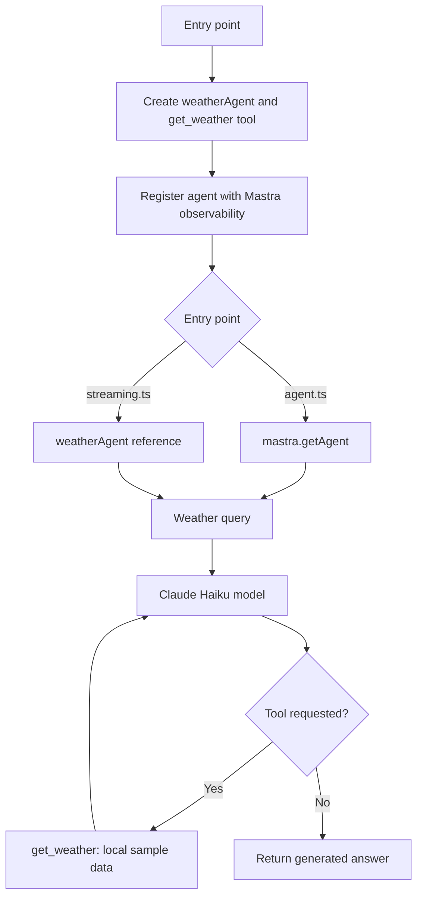
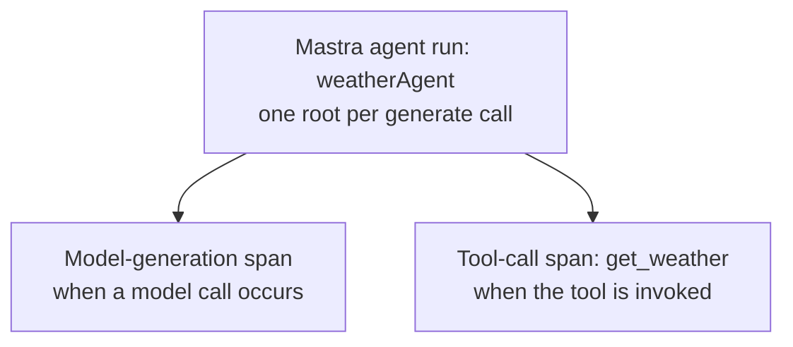
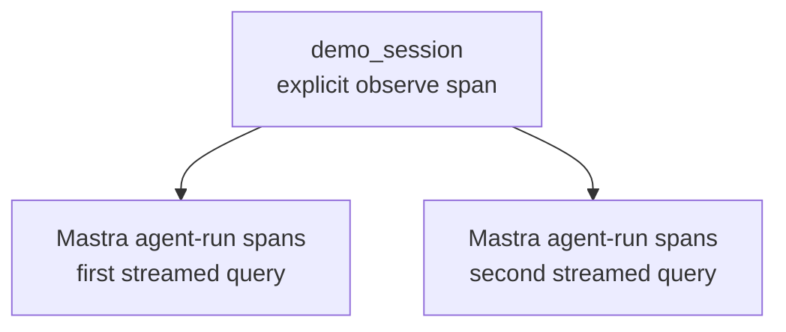

# Mastra Weather Agent (`TypeScript` / `Mastra`)

## Overview

This package demonstrates the same Mastra weather agent through two entry
points. [`agent.ts`](agent.ts) resolves the agent through `mastra.getAgent()`
and calls `generate`; [`streaming.ts`](streaming.ts) exports the agent at
module scope and calls `stream` directly. Both use a `get_weather` tool backed
by fixed local sample data and the `claude-haiku-4-5-20251001` model.

## Architecture and execution flow

The agent receives one of two hard-coded questions and may call `get_weather`
for each requested city. Its tool returns sample temperature, condition and
humidity values; it does not call a live weather service. `agent.ts` runs two
non-streaming `generate` calls through the Mastra registry. `streaming.ts`
calls `weatherAgent.stream` directly and writes text chunks as they arrive.



## TraceRoot instrumentation architecture

`agent.ts` configures `TraceRootExporter` in Mastra's `Observability` object.
Mastra emits spans through its observability pipeline and the exporter sends
them to TraceRoot; this entry point does not call `TraceRoot.initialize`.
Each `agent.generate` call is a separate root trace. `tracingOptions.metadata`
sets `sessionId` and `userId`, grouping the calls in the Sessions view without
making one call the parent of the other.

`streaming.ts` also calls `TraceRoot.initialize({ instrumentModules: {} })` to
create the SDK context, then configures the Mastra exporter. Its explicit
`demo_session` span is the parent for the streamed agent spans because the
current `traceId` and `parentSpanId` are passed in `tracingOptions`. Both
exporters are flushed before their processes exit.

This makes Mastra's model and tool activity, including parentage and session
context, visible in TraceRoot without manually wrapping each framework event.

## Resulting span hierarchy

For `pnpm demo`, each `agent.generate` call has its own Mastra agent-run root;
model-generation and tool-call spans are exported as child activity according
to Mastra's event parent IDs. The two calls share session metadata, not a
common parent. For `pnpm demo:streaming`, the explicit `demo_session` span is
the common parent of both calls. Runtime event names and the presence of a tool
span depend on the execution path.



The streaming entry point adds this outer parent:



## Observed telemetry and supported features

- The Mastra exporter preserves span names, kinds, parent IDs, inputs/outputs,
  and span timing. It maps model provider/model and available input/output
  token counts from model-generation spans.
- `agent.ts` supplies `sessionId` and `userId` in span metadata. The streaming
  version also supplies these identifiers to both the SDK context and Mastra
  span metadata.
- Token usage is present only when Mastra emits usage details. TraceRoot cost
  is conditional on recognized model and usage data; this example does not set
  an explicit cost. Latency is represented by span duration.
- Tool-call telemetry exists only when the agent invokes the tool. The values
  returned by the tool come from the in-memory sample table.

## Prerequisites and environment variables

- Node.js and pnpm.
- A TraceRoot API key and an Anthropic API key.
- [`.env.example`](.env.example) lists `TRACEROOT_API_KEY`,
  `TRACEROOT_HOST_URL` (optional), and `ANTHROPIC_API_KEY`.

## Installation and execution

From this directory, create `.env`, fill in the credentials, install the
dependencies, then run either entry point:

```bash
cp .env.example .env
pnpm install
pnpm demo
pnpm demo:streaming
```

`pnpm demo` runs [`agent.ts`](agent.ts); `pnpm demo:streaming` runs
[`streaming.ts`](streaming.ts).

## File walkthrough

- [`agent.ts`](agent.ts) defines the weather tool and agent, configures the
  Mastra TraceRoot exporter, and runs non-streaming queries.
- [`streaming.ts`](streaming.ts) defines and exports the agent directly,
  propagates the parent TraceRoot context, and streams response chunks.
- [`package.json`](package.json) defines both runnable scripts and their
  dependencies.
- [`tsconfig.json`](tsconfig.json) configures strict TypeScript compilation.
- [`.env.example`](.env.example) documents the required credentials.
